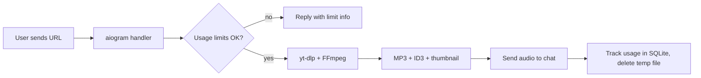

# SoundSync Bot

Telegram bot that downloads the audio of a link with yt-dlp and sends it back as an MP3 with ID3 metadata and cover art. Built with aiogram 3, packaged in Docker, with a GitHub Actions workflow that publishes the image and a script for deploying to a small server (for example a GCP free-tier VM).

<!-- TODO: screenshot of a chat with the bot -->

 

## Features

- Send a URL, receive an MP3 (yt-dlp extraction, FFmpeg conversion at 192 kbps) with title/artist tags and thumbnail.
- Async handlers (aiogram); the blocking download runs in an executor.
- Per-user daily limit (default 5) and a global monthly byte budget (default 1 GiB), stored in SQLite.
- Optional GCP Cloud Monitoring check of network egress to enforce the budget accurately; otherwise it falls back to local file-size tracking.
- Commands: `/start`, `/help`, `/about`, `/my_limit`, `/global_limit`.

## How it works



## Getting started

### Configuration

Copy `.env.example` to `.env`. Variables read by `src/config.py`:

| Variable | Required | Default | Meaning |
|---|---|---|---|
| `BOT_TOKEN` | yes | none | Telegram bot token from BotFather |
| `MAX_USERS_DAILY_LIMIT` | no | `5` | Downloads per user per day |
| `MAX_GLOBAL_MONTHLY_BYTES` | no | `1073741824` | Global monthly transfer budget |
| `DB_PATH` | no | `data/bot_data.db` | SQLite file |
| `GCP_PROJECT_ID`, `GCP_INSTANCE_ID`, `GCP_ZONE` | no | none | Enable GCP egress monitoring |

### Run locally

Prerequisites: Python 3.11+, FFmpeg.

```bash
python3 -m venv venv && source venv/bin/activate
pip install -r requirements.txt
python main.py
```

### Run with Docker

```bash
docker build -t sound-sync-telegram-bot .
docker run --env-file .env sound-sync-telegram-bot
```

### Deploy to a server

`deploy.sh` (run on the server next to your `.env`) pulls `bigalex95/sound-sync-telegram-bot:latest` from Docker Hub, starts the bot with `./data` mounted, and starts [Watchtower](https://containrrr.dev/watchtower/) to check for a new image every 5 minutes.

`.github/workflows/docker-publish.yml` builds the image on push and pull requests, and pushes it to Docker Hub using the `DOCKER_USERNAME` and `DOCKER_PASSWORD` repository secrets. More detail: [docs/deployment.md](docs/deployment.md), [docs/gcp-free-tier.md](docs/gcp-free-tier.md), [docs/hosting_options.md](docs/hosting_options.md), [docs/development.md](docs/development.md).

## Project structure

```
main.py                    entry point
src/config.py              env configuration
src/handlers/              command and URL handlers
src/services/              downloader, cleaner, usage tracker, GCP monitor
src/utils/                 helpers
tests/                     unit tests for limits, tracker, info commands, GCP monitor
docs/                      development, deployment, GCP, hosting notes
n8n/                       description of an alternative no-code design (no workflow file)
Dockerfile, deploy.sh      container image and server deployment
```

## Status and limitations

- Small working project. Tests are in `tests/`; they need `BOT_TOKEN` set and a writable `data/` directory, and are not run in CI.
- Download success depends on yt-dlp and the source site; extractors break when sites change.
- `n8n/README.md` describes an alternative design only; the repository has no n8n workflow export.

## Legal

This bot is intended for personal use. Users are responsible for complying with the terms of service of the source sites and with copyright law in their jurisdiction. Only download content you have the right to download.

## License

MIT, see [LICENSE](LICENSE).
